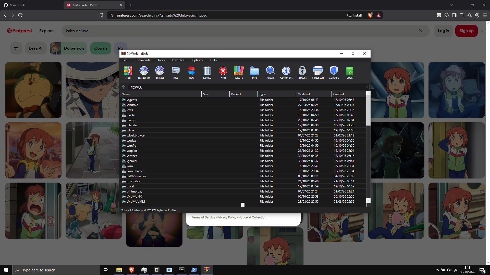

# xRAR

A WinRAR-inspired file archiver built with **C# / .NET 7 / WPF**. Dark themed, native Windows look and feel.

UI layout, toolbar icons, file list columns, registry keys, and file associations were mapped from **reverse engineering the actual WinRAR 7.13 binary** using the REA agent (Ghidra 12.1.4).




---

## Reverse Engineering Source

**Target:** `C:\Program Files\WinRAR\WinRAR.exe`
**SHA-256:** `9ce73bf30a1b85bb85dc02b0177ec362b39587e48b968b411a9ae5cc0557a7c6`
**Version:** 7.13.0 | **Arch:** x86_64 | **Format:** PE
**Provider:** Ghidra 12.1.4 (via REA MCP)
**PDB Reference:** `WinRAR.pdb` (GUID `16881015-1b9a-4c3d-968a-38cb30a1c568`)

### Binary Overview

| Metric | Value |
|--------|-------|
| Procedures | 5,773 |
| Strings | 5,463 |
| Image base | `0x140000000` |
| `.text` | `0x140001000` – `0x1401f4200` (~2 MB) |
| `.rdata` | `0x1401f5000` – `0x140248600` |
| `.data` | `0x140249000` – `0x1402a07ac` |
| `.rsrc` | `0x1402b0000` – `0x14037d600` (~832 KB resources) |

---

## What's From the Binary vs Custom

### Extracted from WinRAR binary (verified)

| Component | Source | Details |
|-----------|--------|---------|
| **19 toolbar icons** | PNG resources from `.rsrc` section | Byte-identical extraction, hash-verified |
| **Toolbar button order** | `Toolbar\*.png` resource name strings | Add → Extract To → Extract → Test → View → Delete → Find → Wizard → Info → Repair → Comment → Protect → VirusScan → Convert → Lock → Report → Benchmark → Print → Exit |
| **10 file list columns** | `$FILELISTCOLUMNS` dialog resource | Name, Size, Packed, Type, Modified, Created, Accessed, Attributes, CRC32, Path |
| **24 file extensions** | `Setup\.*` registry path strings | `.rar .zip .zipx .7z .tar .gz .bz2 .xz .cab .arj .lzh .lz .z .zst .uue .jar .001 .iso .tgz .tbz2 .txz .taz .tbz .tzst` |
| **Registry key structure** | String table | ProgID pattern, OpenWithProgids, Directory context menu, shellex handlers |
| **Menu structure** | `@MAIN_MENU` string references | File, Commands, Tools, Favorites, Options, Help |
| **File type descriptions** | `s:IDS_*` string resources | "WinRAR archive", "ZIP archive", etc. |

### Custom implementation (not from binary)

| Component | Notes |
|-----------|-------|
| **Application code** | WinRAR is native C++; xRAR is a custom C#/WPF reimplementation |
| **Archive engine** | Uses [SharpCompress](https://github.com/adamhathcock/sharpcompress) library |
| **Dark theme colors** | Custom WPF resource dictionary |
| **Dialog implementations** | Custom WPF dialogs, structure informed by binary strings |
| **Status bar format** | Custom text format |

---

## Features

### Archive Support
| Format | Read | Extract | Create |
|--------|------|---------|--------|
| ZIP | Yes | Yes | Yes |
| RAR | Yes | Yes | — |
| 7z | Yes | Yes | — |
| TAR / GZ / BZ2 / XZ | Yes | Yes | — |
| CAB / ARJ / LZH / ISO | Yes | Yes | — |

### UI
- **Dark theme** — custom WPF theme with dark title bar, accent highlights
- **19 toolbar buttons** — icons extracted from WinRAR binary, order matching original
- **10-column file list** — Name, Size, Packed, Type, Modified, Created, Accessed, Attributes, CRC32, Path
- **Address bar** — editable path with autocomplete
- **Status bar** — item count and total size
- **Drive tree** — sidebar with all available drives
- **Drag & drop** — extract files by dragging out of the archive

### File Associations
- **Auto-register on first run** — silently registers all 24 archive extensions (user-level, no admin required)
- **Double-click to open** — double-clicking any archive in Explorer opens it in xRAR
- **Settings → Integration** — manage per-extension associations, register/unregister all
- **Supported extensions**: `.rar .zip .zipx .7z .tar .gz .bz2 .xz .cab .arj .lzh .lz .z .zst .uue .jar .001 .iso .tgz .tbz2 .txz .taz .tbz .tzst`

### Installer
- **Inno Setup** based installer (`installer.iss`)
- Default install path: `C:\Program Files\xRAR`
- Registers file associations at machine level (admin)
- Creates Start Menu + optional Desktop shortcuts
- Full uninstaller

---

## Project Structure

```
xRAR/
├── src/
│   └── xRAR/
│       ├── App.xaml / App.xaml.cs          # Entry point, CLI arg handling, auto-register
│       ├── MainWindow.xaml / .cs           # Main window UI + logic
│       ├── Themes/
│       │   └── DarkTheme.xaml              # Dark theme resource dictionary
│       ├── Models/
│       │   └── FileSystemItem.cs           # File/folder model + archive detection
│       ├── Services/
│       │   ├── ArchiveService.cs           # Archive open/extract/create/test
│       │   ├── FileAssociationService.cs   # Registry file association management
│       │   └── IconExtractor.cs            # Shell icon extraction
│       ├── Views/
│       │   ├── AddDialog.xaml(.cs)
│       │   ├── ExtractDialog.xaml(.cs)
│       │   ├── FindDialog.xaml(.cs)
│       │   ├── InfoDialog.xaml(.cs)
│       │   ├── SettingsDialog.xaml(.cs)    # Settings with Integration tab
│       │   ├── WizardDialog.xaml(.cs)
│       │   └── AboutDialog.xaml(.cs)
│       └── Resources/
│           └── Icons/                      # 100+ icons extracted from WinRAR binary
├── docs/
│   └── screenshot.png
├── installer.iss                           # Inno Setup installer script
├── build.ps1                               # Build + package script
├── LICENSE                                 # MIT
├── .gitignore
└── README.md
```

---

## Building

### Prerequisites
- [.NET 7 SDK](https://dotnet.microsoft.com/download/dotnet/7.0)
- [Inno Setup 6+](https://jrsoftware.org/isdl.php) (for installer only)

### Debug Build
```bash
cd src/xRAR
dotnet build
dotnet run
```

### Release + Installer
```powershell
.\build.ps1
```

Output: `dist\xRAR-Setup-1.0.0.exe`

---

## How File Association Works

1. **First launch** — `App.OnStartup` calls `FileAssociationService.AutoRegisterIfNeeded()`
2. **Registry** — writes to `HKCU\Software\Classes` (user-level, no admin needed):
   ```
   .zip                          → xRAR.zip
   xRAR.zip\shell\open\command   → "xRAR.exe" "%1"
   ```
3. **Double-click** — Windows launches `xRAR.exe "path\to\file.zip"`
4. **App startup** — `App.StartupFilePath` captures the arg, `MainWindow_Loaded` calls `OpenArchive()`
5. **Installer** — additionally registers at `HKCR` (machine-level) via Inno Setup `[Registry]` section

---

## Tech Stack

- **C# 11 / .NET 7** — target framework
- **WPF** — UI framework
- **SharpCompress** — archive library (ZIP, RAR, 7z, TAR, GZ, etc.)
- **Inno Setup** — installer
- **Windows Registry** — file associations
- **REA MCP + Ghidra 12.1.4** — reverse engineering WinRAR 7.13

---

## License

MIT — see [LICENSE](LICENSE)
